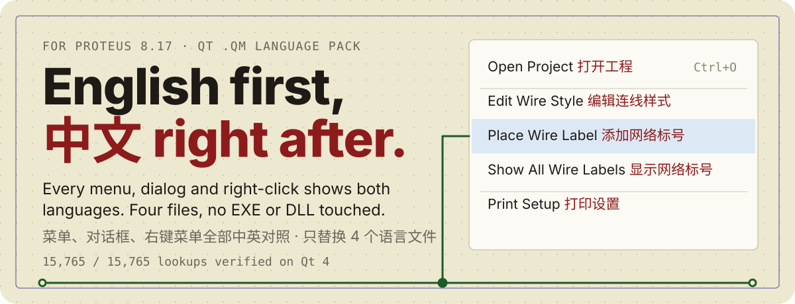
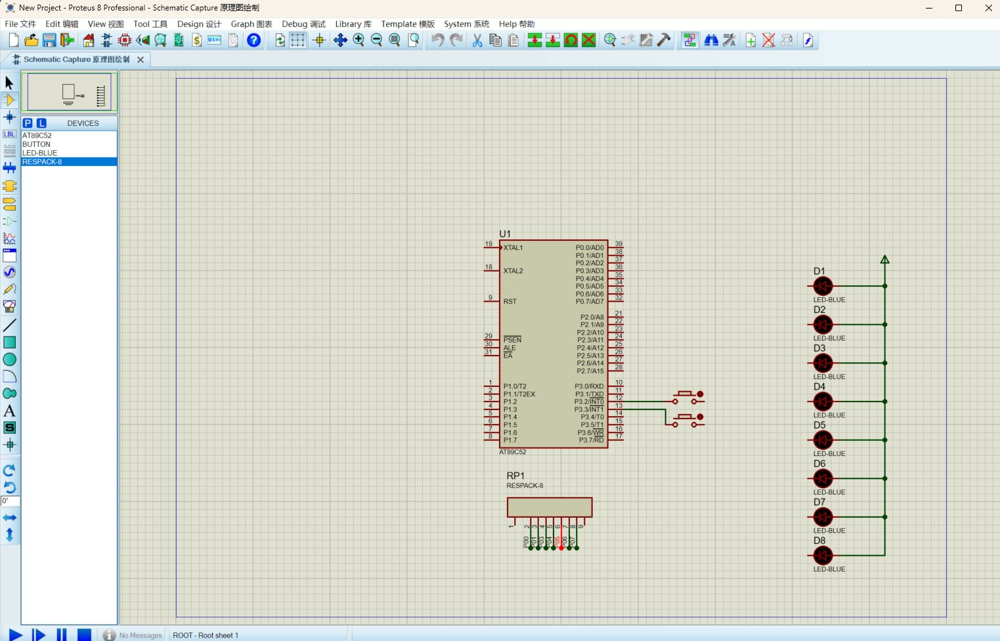
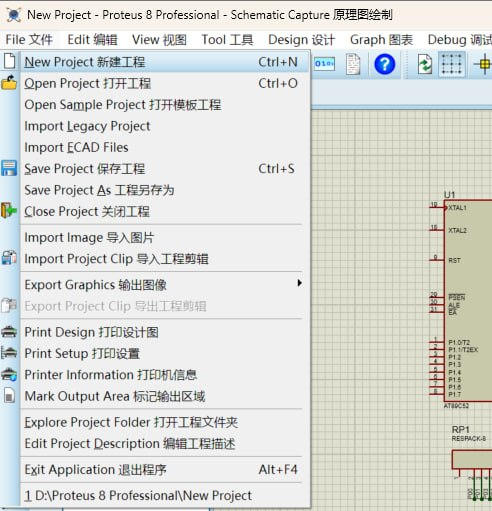
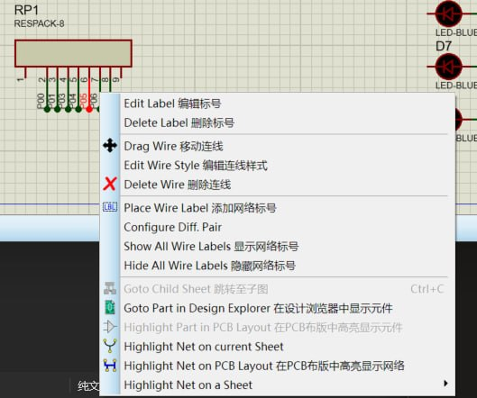
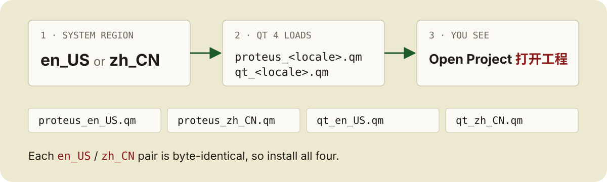

  

<b>English</b> · <a href="./README.zh-CN.md">简体中文</a>

Replaces the language files of **Proteus 8 Professional 8.17** so every menu, dialog and right-click label reads `English 中文`. Handy when you follow English tutorials or datasheets but still want the Chinese next to each term.

Only `.qm` translation files are swapped. No EXE, DLL, component library or license is touched.

  

<table>
  <tr>
    <td width="50%"></td>
    <td width="50%"></td>
  </tr>
</table>

## Install (Windows)

1. Save your project and fully quit Proteus.
2. **Back up** the whole `Translations` folder in your Proteus install directory.
3. Copy the four files from [`release/Translations/`](release/Translations) into that `Translations` folder, replacing files with the same name. Don't nest an extra folder.
4. Start Proteus.

**Undo:** quit Proteus and restore your backup. If you had no `*_en_US.qm` files before, deleting `proteus_en_US.qm` and `qt_en_US.qm` is enough.

### Why four files?

  

Proteus's bundled Qt 4 picks the file by system region. Some machines report `en_US` even when Windows is set to Chinese, so installing only the `zh_CN` pair silently does nothing. This does not change your Windows language or region.

## What is covered

| Area | Result |
|---|---|
| Original pack | All 6,226 main-catalog entries kept, lookup keys unchanged, now English first |
| Code editor | 554 commands, syntax-highlighting and style names added |
| Menus and dialogs | 1,902 labels read from the installed EXE/DLL resources (resource-name and case aliases included, so alias count is not the translation count) |
| Qt widgets | 53 entries from the official Qt 4.8 `zh_CN` catalog that the original pack lacked |
| Left as-is | Component identifiers, file paths, protocol names, numbers, shortcuts |

**Not covered:** help files, sample projects, component data, and any text hard-coded in Proteus that never goes through the translation API.

**Known limit:** fixed-width buttons, menus and dialogs can truncate the longer bilingual text. I have checked the menu bar, File menu, right-click menus and schematic capture in Proteus 8.17 (screenshots above), not every screen.

## How it was verified

The files were read back entry by entry through the `QtCore4.dll` that ships with Proteus, in a separate 32-bit Python process: 15,765 / 15,765 main-catalog and 1,451 / 1,451 Qt-catalog lookups pass, and both file types auto-load under the `en_US` locale. Original keys, entry counts, `printf` placeholder counts and tab-separated shortcuts were also compared with the source pack. Details and SHA-256 hashes are in [`release/validation.json`](release/validation.json).

## Rebuild it yourself

`tools/` holds the generator scripts. They need Windows, an installed Proteus and 32-bit Python (for `QtCore4.dll`).

| Script | Job |
|---|---|
| `qm_catalog.py` | Read a full `.qm`, handling Qt's empty-string marker |
| `build_complete.py` | Build the bilingual catalog and merge extra entries |
| `qscintilla_zh.py`, `new_labels_zh.py` | Supplementary Chinese dictionaries |
| `extract_ui_resources.py`, `inspect_resources.py` | Read menu and dialog resources from the EXE/DLLs |
| `qt4_verify.py` | Verify lookups with Proteus's own Qt 4 runtime |
| `package_complete.py` | Package the release |

Paths come from two environment variables: `PROTEUS_DIR` (install folder containing `BIN`) and `ORIGINAL_PATCH_DIR` (folder with the original Chinese pack). After switching from hard-coded paths to these variables the scripts were only syntax-checked, not fully re-run. Please open an issue if one breaks.

## Sources, license and disclaimer

- Scripts in `tools/` are MIT-licensed: see [LICENSE](LICENSE).
- The `.qm` files and `data/` are derived from third-party material and are **not** covered by that license. Attribution is in [NOTICE.md](NOTICE.md). The author and license of the original Chinese pack are unknown, so redistribution rights are not established.
- Proteus is a product of Labcenter Electronics. This project is unaffiliated and ships **no** Proteus binaries, installer or license; you need your own legitimate copy.
- If you are a rights holder and want something removed or credited, open an issue and it will be handled promptly.
